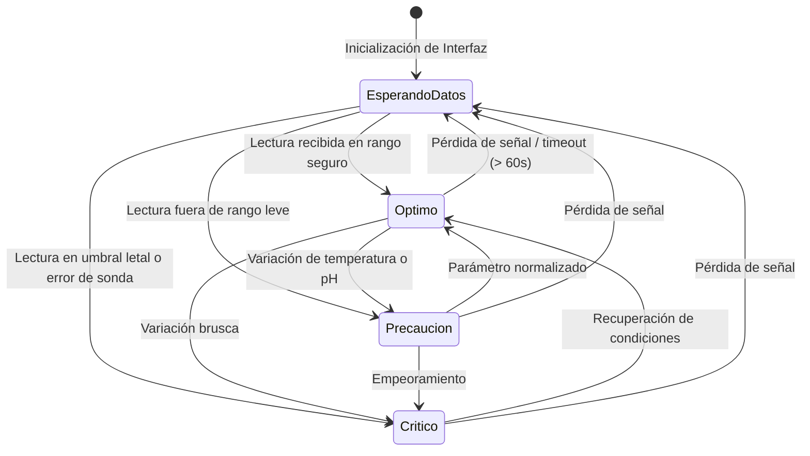

# Data Model & Interface States: Dashboard Web Layout

**Feature**: `001-dashboard-web-layout`

## Entidades Visuales y de Datos

### 1. `BoyaDeviceState`
Representa el estado de salud y conectividad de la boya en el encabezado principal del dashboard.

| Campo | Tipo | Valores Permitidos | Descripción |
| :--- | :--- | :--- | :--- |
| `id` | String | ej. `"BOYA-TILAPIA-01"` | Identificador único del dispositivo en campo. |
| `status` | String | `"online" \| "offline" \| "warning"` | Estado de recepción de señal. |
| `lastSync` | String / ISO Date | Timestamp legible | Momento de la última telemetría recibida. |
| `pondName` | String | ej. `"Estanque Principal - Alevines"` | Nombre del tanque o ubicación física. |

### 2. `TelemetryCardMetric`
Representa la información y apariencia visual de cada tarjeta de métrica acuícola y de integridad física de la boya.

| Campo | Tipo | Formato / Rango | Descripción |
| :--- | :--- | :--- | :--- |
| `parameterKey` | String | `"water_temp" \| "ph" \| "internal_hum"` | Identificador clave del sensor: DS18B20 (`water_temp`), PHE-45P (`ph`), o interno ESP32 (`internal_hum`). |
| `title` | String | ej. `"Temperatura del Agua"`, `"pH del Agua"`, `"Humedad Interna (Boya)"` | Título descriptivo de la tarjeta. |
| `value` | Number / String | ej. `28.4`, `7.2`, `55` o `"--"` | Valor medido actual formateado. |
| `unit` | String | `"°C" \| "pH" \| "%"` | Unidad de medida visible. |
| `optimalRange` | String | ej. `"26.0 - 30.0 °C"`, `"6.5 - 8.5"`, `"< 70 %"` | Texto de referencia operativa (calidad de agua / estanqueidad ESP32). |
| `healthStatus` | String | `"optimal" \| "caution" \| "critical"` | Estado evaluado contra los umbrales. |
| `badgeLabel` | String | `"Óptimo" \| "Alerta" \| "Crítico"` | Etiqueta en la insignia de la tarjeta. |

### 3. `ChartSlot`
Representa los contenedores modulares destinados a albergar los gráficos de Node-RED.

| Campo | Tipo | Valores Permitidos | Descripción |
| :--- | :--- | :--- | :--- |
| `slotId` | String | `"chart-water-quality" \| "chart-ambient"` | Identificador del bloque contenedor ("Calidad de Agua" vs "Ambiente Interno"). |
| `title` | String | ej. `"Tendencia de Calidad de Agua"` | Título en el encabezado de la tarjeta. |
| `selectedTimeframe`| String | `"1h" \| "6h" \| "24h"` | Período de visualización seleccionado. |
| `state` | String | `"placeholder" \| "loading" \| "active" \| "error"` | Estado visual del contenedor. |
| `embedUrl` | String | URL de Node-RED o vacía | Destino del iframe cuando esté disponible. |

---

## Diagrama de Estados de la Tarjeta Métrica

