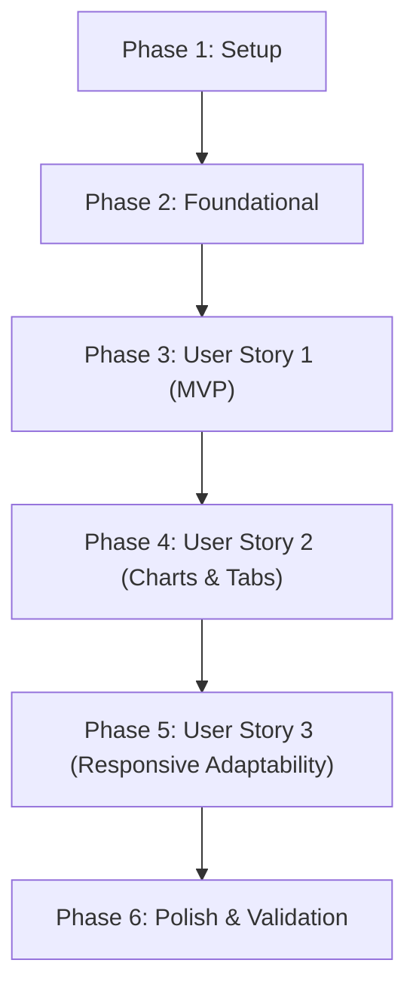

# Tasks: Dashboard Web Layout and Visual Design

**Input**: Design documents from `/specs/001-dashboard-web-layout/`
**Prerequisites**: `plan.md`, `spec.md`, `research.md`, `data-model.md`, `contracts/ui-contracts.md`, `quickstart.md`

## Format: `[ID] [P?] [Story] Description with file path`

- **[P]**: Can run in parallel (different files, no dependencies)
- **[Story]**: Which user story this task belongs to (`[US1]`, `[US2]`, `[US3]`)
- Every task includes explicit file paths

---

## Phase 1: Setup (Shared Infrastructure)

**Purpose**: Project initialization and basic structure for the dashboard frontend.

- [X] T001 Configure HTML5 document scaffolding, meta viewport, and Lucide Icons CDN script in `web/index.html`
- [X] T002 [P] Setup CSS architecture with reset, system typography, and CSS custom property tokens for pure white theme in `web/style.css`
- [X] T003 [P] Initialize JavaScript application controller module with DOMContentLoaded event listener in `web/app.js`

---

## Phase 2: Foundational (Design System & Reusable Components)

**Purpose**: Core CSS utilities and JavaScript state evaluators required across all user stories.

**⚠️ CRITICAL**: Must complete before any user story UI tasks can be finalized.

- [X] T004 Define core workbench design tokens (`--bg-page: #ffffff`, `--bg-card: #ffffff`, `--border: #e2e8f0`, `--radius: 0.75rem`, `--color-primary: #0284c7`) and card utility classes in `web/style.css`
- [X] T005 [P] Implement tilapia parameter range evaluation helpers (`water_temp: 26-30 °C`, `ph: 6.5-8.5`, `ambient_hum: 50-80%`) returning `"optimal"`, `"caution"`, or `"critical"` in `web/app.js`
- [X] T006 [P] Implement Lucide icon initialization wrapper and dynamic re-render helper in `web/app.js`

**Checkpoint**: Foundation ready - UI user story implementation can begin.

---

## Phase 3: User Story 1 - Visualización del Panel Principal y Métricas Clave (Priority: P1) 🎯 MVP

**Goal**: Deliver the primary monitoring view: header bar with connection badge and 3 telemetry metric cards (Water Temperature, pH, Humidity) with visual health badges and automated 5-second updates.

**Independent Test**: Open `web/index.html` in browser. Observe buoy header with "En línea" badge, 3 cards with units (°C, pH, %), biological reference ranges, and live numerical updates every 5 seconds.

### Implementation for User Story 1

- [X] T007 [US1] Build header markup with system title "Boya IoT · Estanque de Tilapias", device badge slot, and last sync timestamp in `web/index.html`
- [X] T008 [US1] Build telemetry metric cards markup for Water Temperature, pH Level, and Ambient Humidity with icon containers and value slots in `web/index.html`
- [X] T009 [US1] Style header bar, connection status pills (online/offline/warning), and telemetry metric cards with tabular numbers (`tabular-nums`) and subtle shadows in `web/style.css`
- [X] T010 [US1] Implement DOM binding function `renderTelemetry(data)` to update card numbers, badges, and sync timestamp in `web/app.js`
- [X] T011 [US1] Implement 5-second automatic simulation timer oscillating telemetry values realistically within safe tilapia ranges in `web/app.js`

**Checkpoint**: User Story 1 is fully functional and delivers an independently testable MVP.

---

## Phase 4: User Story 2 - Contenedores Modulares y Placeholders para Gráficos de Node-RED (Priority: P2)

**Goal**: Deliver a panoramic modular chart container equipped with tabs ("Calidad de Agua" vs "Ambiente"), timeframe filters (1H, 6H, 24H), styled placeholder, and decoupled `<iframe>` slot for Node-RED.

**Independent Test**: Open `web/index.html`. Click between "Calidad de Agua" and "Ambiente" tabs, toggle timeframe buttons, and verify placeholder reserves a minimum height of 340px without layout shifts.

### Implementation for User Story 2

- [X] T012 [US2] Build tabbed chart container markup with tab bar buttons ('Calidad de Agua' vs 'Ambiente') and timeframe selector buttons ('1H', '6H', '24H') in `web/index.html`
- [X] T013 [US2] Build chart content area with styled placeholder message, icon, topic badge, and decoupled responsive `<iframe>` element in `web/index.html`
- [X] T014 [US2] Style tabbed chart panel, active tab pill indicators, timeframe toggle buttons, and responsive iframe wrapper (`min-height: 340px`) in `web/style.css`
- [X] T015 [US2] Implement tab switching click handlers to toggle active chart view and update visual tab state in `web/app.js`
- [X] T016 [US2] Implement timeframe button click handlers and custom event dispatcher (`tilapia:timeframe-change`) in `web/app.js`

**Checkpoint**: User Stories 1 and 2 are functional together.

---

## Phase 5: User Story 3 - Adaptabilidad Responsiva para Operación en Campo (Priority: P3)

**Goal**: Ensure fluid responsive adaptability across mobile smartphones (field inspection at pond edge), tablets, and desktop workstations without horizontal scroll.

**Independent Test**: Resize browser window from 360px to 1920px. Confirm cards transition from a single stacked column to multi-column grid, and chart panel preserves proportions.

### Implementation for User Story 3

- [X] T017 [US3] Implement mobile CSS media queries (`max-width: 768px`) for vertical card stacking, touch-friendly hit targets (min 44px), and compact header in `web/style.css`
- [X] T018 [US3] Implement desktop CSS Grid layout (`min-width: 1024px`) arranging metric cards in a 3-column row and chart container in full-width panoramic span in `web/style.css`
- [X] T019 [US3] Implement ultra-small viewport safeguards (`360px`) preventing text truncation, card overflow, and horizontal scrolling in `web/style.css`

**Checkpoint**: All user stories are functionally and visually complete across all target devices.

---

## Phase 6: Polish & Cross-Cutting Concerns

**Purpose**: Visual refinements, accessibility compliance, and end-to-end validation.

- [X] T020 [P] Add accessibility attributes (ARIA roles for tabs, `aria-live` for telemetry updates, semantic landmarks) in `web/index.html`
- [X] T021 [P] Refine transition animations for card values, badge color shifts, and tab indicator highlighting in `web/style.css`
- [X] T022 Execute visual validation scenarios per `specs/001-dashboard-web-layout/quickstart.md` across mobile and desktop viewports

---

## Dependencies & Execution Order

### Phase Dependencies

### User Story Dependencies

- **US1 (P1 - Telemetry Metrics)**: Depends on Phase 2 (Foundational). Can be built and demonstrated independently as the MVP.
- **US2 (P2 - Chart Containers & Tabs)**: Depends on Phase 2. Integrates directly into the main page below US1 cards.
- **US3 (P3 - Responsive Grid)**: Depends on US1 and US2 markup existing to apply responsive media queries.

---

## Implementation Strategy (MVP First)

1. **Step 1 (Foundation)**: Execute T001–T006. Establishes the pure white workbench design system and helper utilities.
2. **Step 2 (MVP Delivery - User Story 1)**: Execute T007–T011. Deliver functioning dashboard header and 3 live telemetry cards with auto-simulation. **Validate MVP.**
3. **Step 3 (Chart Containers - User Story 2)**: Execute T012–T016. Deliver tabbed chart panel with iframe readiness for Node-RED.
4. **Step 4 (Field Responsiveness - User Story 3)**: Execute T017–T019. Polish mobile/tablet layouts for outdoor pond inspection.
5. **Step 5 (Final Polish)**: Execute T020–T022. Verify accessibility, smooth transitions, and quickstart scenarios.
