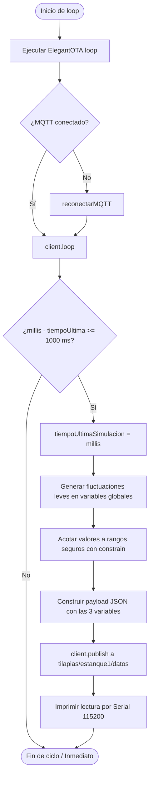

# Data Model: Variables Globales Oficiales y Simulación de Telemetría ESP32

**Feature**: `002-esp32-telemetry-simulation`

## Entidades y Variables Globales en Firmware (`main.cpp`)

### 1. Variables Globales de Telemetría Oficiales

Almacenan el estado más reciente de las 3 variables oficiales analizadas en el sistema:

| Nombre de Variable | Tipo | Valor Inicial | Rango Operativo Seguro | Unidad | Descripción |
| :--- | :--- | :--- | :--- | :--- | :--- |
| `temperatura_agua` | `float` | `26.5` | `25.0 - 31.0` | °C | Temperatura del agua (asignada a futuro a sonda DS18B20 sumergible). |
| `ph_agua` | `float` | `7.20` | `6.50 - 8.50` | pH | Nivel de pH del agua (asignada a futuro a sonda PHE-45P). |
| `humedad_interna` | `float` | `55.0` | `45.0 - 75.0` | % HR | Humedad relativa interna del gabinete de la boya al lado del ESP32. |

### 2. Variables de Control de Temporización

Gestionan la ejecución no bloqueante a una cadencia de 1 segundo:

| Nombre de Variable | Tipo | Valor / Constante | Descripción |
| :--- | :--- | :--- | :--- |
| `INTERVALO_SIMULACION` | `const unsigned long` | `1000` | Período de simulación en milisegundos (1 segundo). |
| `tiempoUltimaSimulacion` | `unsigned long` | `0` | Registro temporal (`millis()`) de la última ejecución del ciclo de simulación. |

---

## Estructura del Payload JSON Emitido

Representación del paquete de telemetría publicado al broker MQTT (`tilapias/estanque1/datos`):

```json
{
  "temperatura": 26.5,
  "ph": 7.20,
  "humedad_interna": 55.0
}
```

### Diccionario de Campos del Payload:

- **`temperatura`** (Numérico, 1 decimal): Medición en grados Celsius de la temperatura del agua.
- **`ph`** (Numérico, 2 decimales): Medición en escala de acidez/alcalinidad (0-14).
- **`humedad_interna`** (Numérico, 1 decimal): Medición de humedad relativa (%) dentro de la boya para control de estanqueidad.

---

## Ciclo de Vida y Flujo en `loop()`


