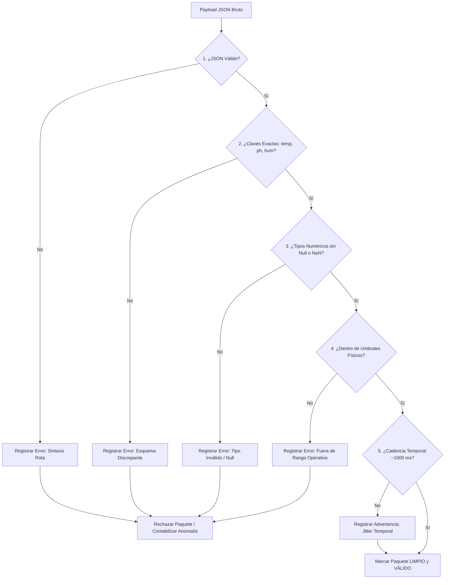

# Data Model: Entorno de Pruebas y Validación Limpia de Telemetría

**Feature**: `003-telemetry-test-environment`

## Modelos de Datos del Entorno de Pruebas

### 1. `TelemetryPackage` (Paquete de Telemetría Evaluado)

Representa la unidad de telemetría individual extraída del payload JSON.

| Atributo | Tipo | Restricción / Formato | Descripción |
| :--- | :--- | :--- | :--- |
| `temperatura` | `float` | `24.0 <= valor <= 32.0` (1 decimal) | Temperatura del agua en °C. |
| `ph` | `float` | `6.00 <= valor <= 9.00` (2 decimales) | Nivel de acidez/alcalinidad del estanque. |
| `humedad_interna` | `float` | `40.0 <= valor <= 80.0` (1 decimal) | Humedad relativa interna del gabinete ESP32. |
| `timestamp` | `float` | Epoch en segundos / `time.time()` | Momento exacto de generación o recepción. |
| `raw_payload` | `str` | Cadena JSON serializada | Texto original emitido hacia el broker. |

---

### 2. `ValidationResult` (Resultado de Validación de Limpieza)

Representa el veredicto emitido por el validador sobre un paquete de datos.

| Atributo | Tipo | Valores Permitidos | Descripción |
| :--- | :--- | :--- | :--- |
| `is_clean` | `bool` | `True \| False` | `True` si el paquete cumple todas las reglas de limpieza. |
| `errors` | `List[str]` | Lista de cadenas descriptivas | Mensajes de error en caso de anomalías encontradas. |
| `warnings` | `List[str]` | Lista de advertencias | Avisos sobre valores cercanos a límites de advertencia. |
| `delta_time_ms` | `float \| None` | Milisegundos transcurridos | Diferencia de tiempo respecto a la muestra previa. |

---

### 3. `TestSuiteReport` (Reporte Consolidado de la Sesión de Pruebas)

Estructura de resumen emitida al concluir una sesión de pruebas.

| Atributo | Tipo | Descripción |
| :--- | :--- | :--- |
| `total_samples` | `int` | Total de paquetes analizados en la corrida. |
| `clean_samples` | `int` | Número de paquetes conformes y limpios al 100%. |
| `corrupted_samples` | `int` | Número de paquetes rechazados por anomalías. |
| `cleanliness_rate_percent`| `float` | Porcentaje de limpieza (`clean_samples / total_samples * 100`). |
| `avg_interval_ms` | `float` | Intervalo temporal promedio observado entre paquetes. |
| `overall_verdict` | `str` | `"APROBADO"` (100% limpios) o `"RECHAZADO"`. |

---

## Diagrama de Flujo del Proceso de Validación

