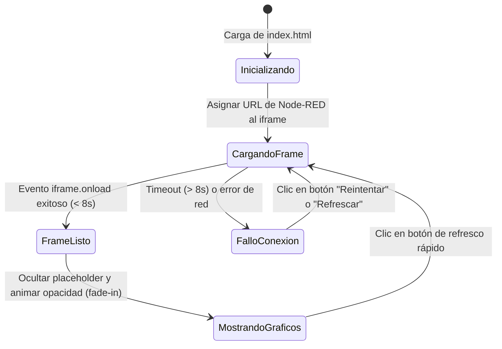

# Data Model: Estado y Configuración de Incrustación de Node-RED

**Feature**: `005-embed-nodered-charts`

## Entidades de la Interfaz Web (`web/app.js`)

### 1. `NodeRedEmbedState` (Estado de Conexión del Marco Embebido)

Controla el estado visual y operacional del contenedor de gráficos.

| Campo | Tipo | Valores Permitidos | Descripción |
| :--- | :--- | :--- | :--- |
| `url` | `String` | URL HTTP válida | Destino del marco embebido (ej. `http://localhost:1880/ui/#!/0`). |
| `status` | `String` | `"loading" \| "ready" \| "error"` | Estado de carga del elemento `<iframe>`. |
| `lastRefreshed` | `Date` | Timestamp local | Momento del último refresco manual o automático del frame. |
| `activeTab` | `String` | `"water" \| "ambient"` | Pestaña activa seleccionada en el panel del dashboard. |

---

### 2. Elementos DOM Vinculados

| Identificador DOM | Tipo de Elemento | Función |
| :--- | :--- | :--- |
| `iframe-water` | `HTMLIFrameElement` | Marco principal que contiene los gráficos de Node-RED. |
| `placeholder-water`| `HTMLDivElement` | Tarjeta de estado de carga previa al enlace del iFrame. |
| `btn-refresh-chart`| `HTMLButtonElement` | Botón para recargar el `src` del frame en demanda. |
| `btn-open-nodered` | `HTMLAnchorElement` | Enlace externo a `http://localhost:1880/ui/` en nueva pestaña. |

---

## Diagrama de Estados del Contenedor de Gráficos

